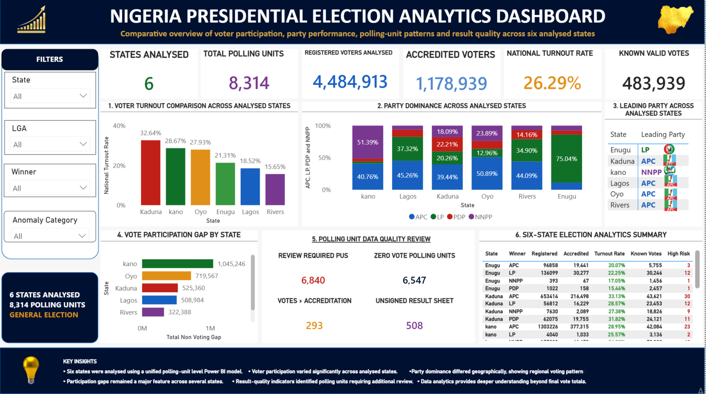
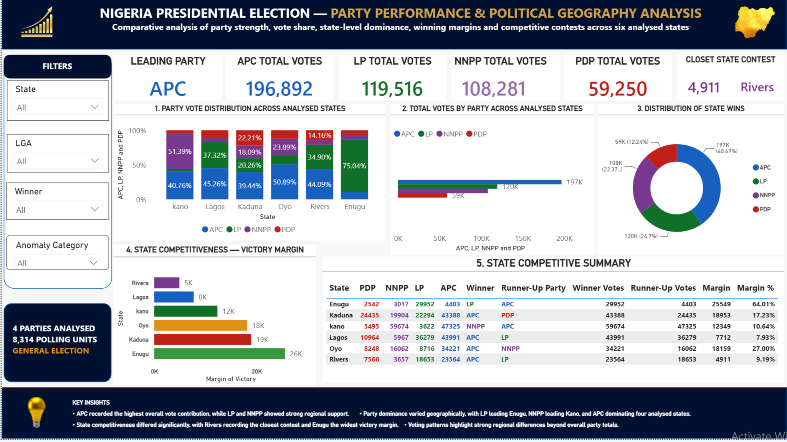
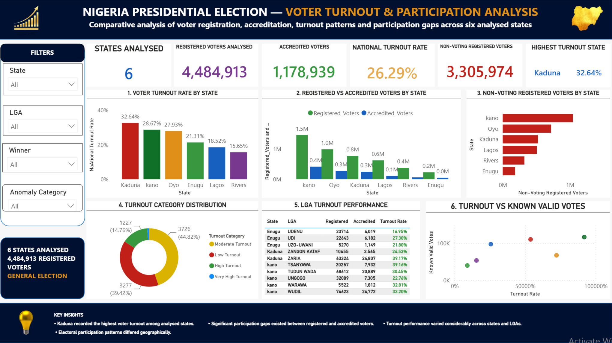
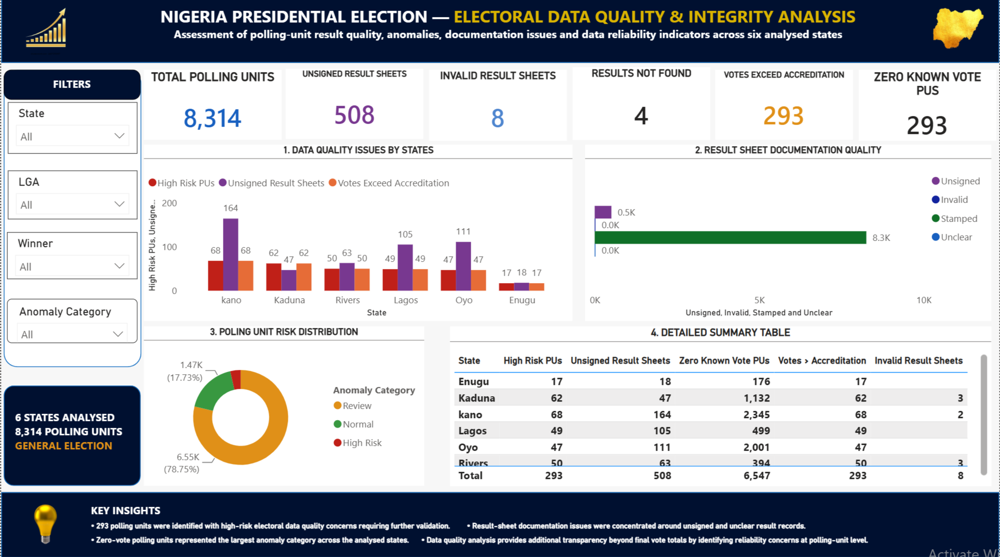
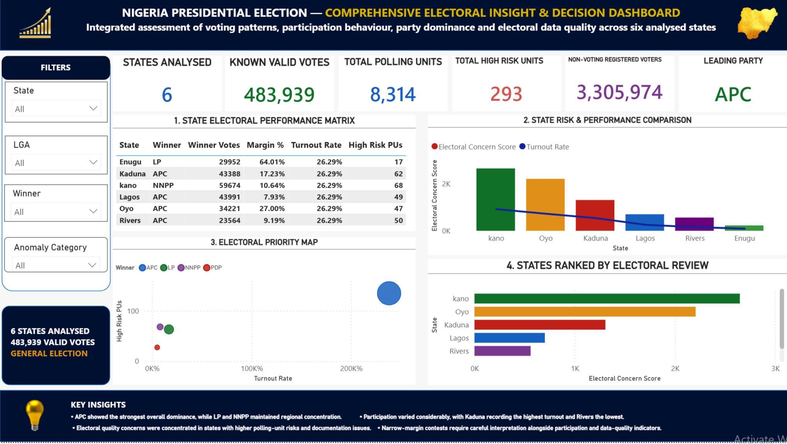

# Consolidated Six-State Dashboard Analysis

This folder contains screenshots of the five Power BI dashboards developed from the combined datasets of Lagos, Kaduna, Kano, Oyo, Enugu and Rivers States.

The dashboards provide comparative insights into national party performance, voter participation, electoral data quality, state-level electoral patterns and overall election analysis.

## Dashboard Previews

### 1. National Party Performance

### 2. Voter Turnout Analysis

### 3. Electoral Data Quality

### 4. State-Level Electoral Patterns

### 5. Overall Election Analysis

